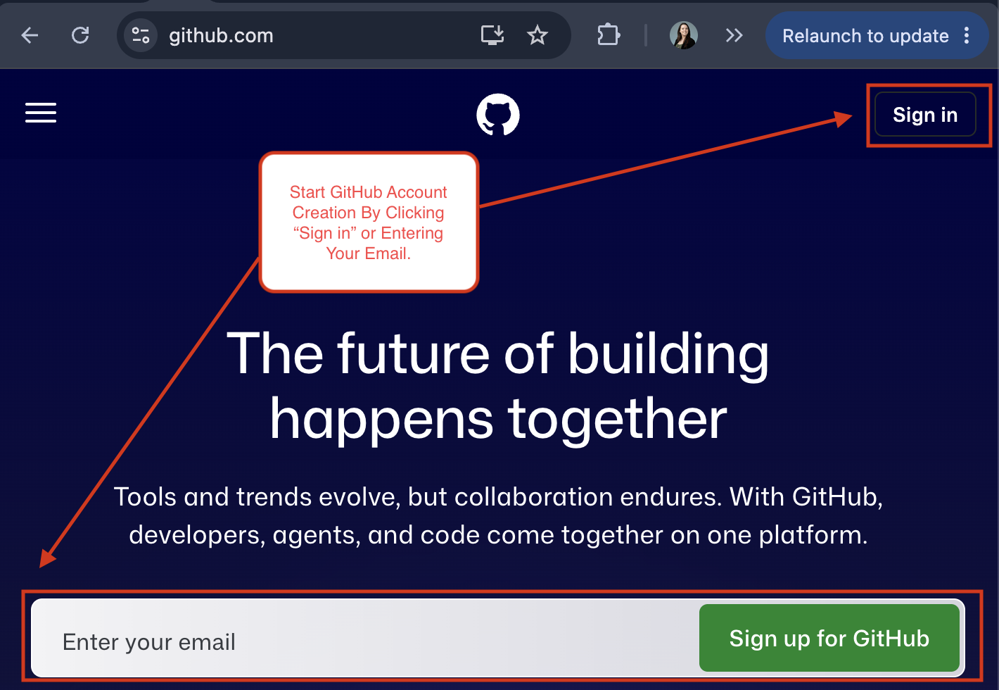
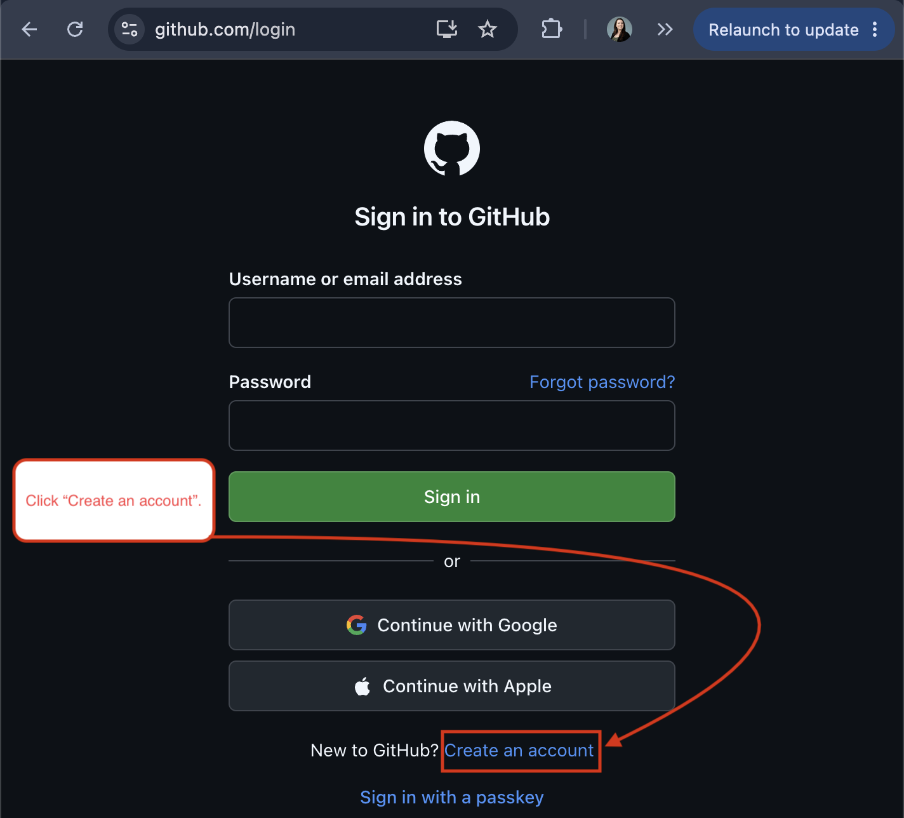
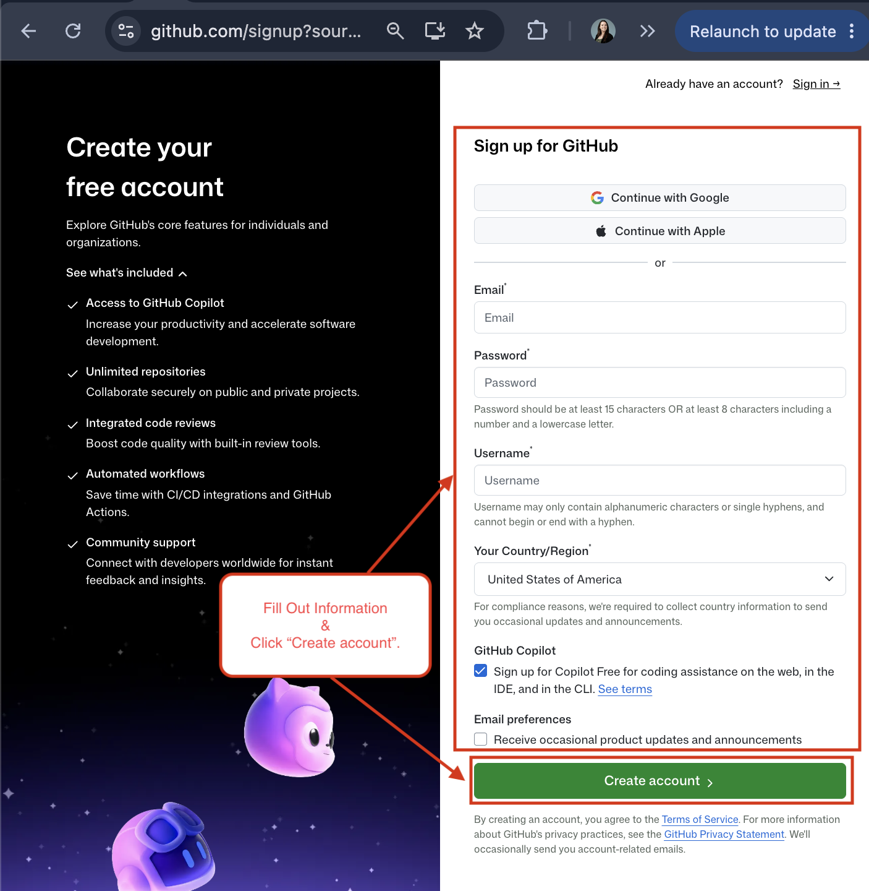
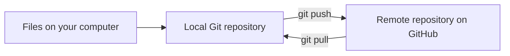
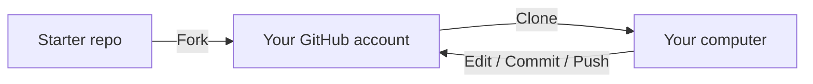
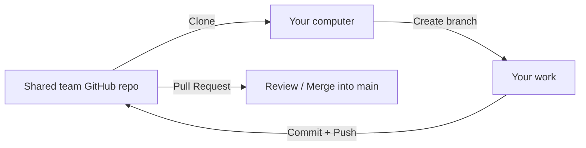

# Git/GitHub Development Environment

**Purpose:** Explain the Git/GitHub workflow used in our projects, including repositories, branches, and `.gitignore`.

> **Beginner goal:** Understand what Git, GitHub, and GitHub Desktop are and how to work through basic repository workflows.

---

## Table of Contents

1. [Explaining Git, GitHub, and GitHub Desktop](#explaining-git-github-and-github-desktop)
2. [Setting Up a GitHub Account](#setting-up-a-github-account)
3. [Key Vocabulary](#key-vocabulary)
4. [Local vs. Remote Repositories](#local-vs-remote-repositories)
5. [Fork vs. Clone vs. Branch](#fork-vs-clone-vs-branch)
6. [Forking a Repo](#forking-a-repo)
7. [Creating and Collaborating in a Shared Repo](#creating-and-collaborating-in-a-shared-repo)
8. [Git Workflow: Branching, Commits, Pushing, Testing, and Merging](#git-workflow-branching-commits-pushing-testing-and-merging)
9. [Reliable Resources](#reliable-resources)
10. [One-Minute Summary](#one-minute-summary)

---

## Explaining Git, GitHub, and GitHub Desktop

These tools work together, but they are **not the same thing**.

| Tool | What It Is | What It Does |
|---|---|---|
| **Git** | Version-control system installed on your computer | Tracks file changes over time, creates commits, supports branches, and lets developers return to earlier versions. |
| **GitHub** | Online/remote repository host | Stores repositories online so work can be backed up, shared, reviewed, and collaborated on. |
| **GitHub Desktop** | Graphical interface for Git | Provides buttons and visual tools for many Git tasks instead of requiring terminal commands. |

A simple way to think about them:

```text
Git = tracks the project (Version-Control System)
GitHub = hosts/shares/backs up the project online (Online repository hosting service)
GitHub Desktop = visual controls for Git (Desktop Application to Simplify Git Tasks)
```

---

## Setting Up a GitHub Account

If you do not have a GitHub account, follow these instructions to set one up.

1. Go to [GitHub's website](https://github.com/).

2. Begin the account creation process by entering your email on the GitHub home page or by clicking **Sign in** in the top-right corner.

    The steps below use the **Sign in** method.

    

3. On the sign-in page, click the **Create an account** link below the sign-in options.

    

4. Fill in the required account information and click the green **Create account** button at the bottom of the page.

    

Your account is set up, and you are ready to move on to the basics. 

The sections below cover:

- Git Basics/Vocabulary
- Working With Two Different Workflow Types
- Branching, Commits, Pushing, Testing, and Merging

---

## Key Vocabulary

| Term | Beginner-Friendly Meaning |
|---|---|
| **Repository / Repo** | The project folder Git is tracking. |
| **Local repository** | The copy of the repository stored on your computer. |
| **Remote repository** | The copy hosted online, such as on GitHub. |
| **Working directory** | The files you are currently editing. |
| **Staging area** | The group of changes selected for the next commit. |
| **Commit** | A saved snapshot of staged changes in the **local** repository. |
| **Push** | Sends local commits to GitHub. |
| **Pull** | Brings newer remote changes down to your local repository. |
| **Branch** | A separate line of work inside the same repository. |
| **Main** | The default branch in most new GitHub repositories. |
| **Pull request (PR)** | A request on GitHub to review and merge one branch into another. |
| **Clone** | Downloads a remote repository and creates a connected local copy. |
| **Fork** | Creates a copy of someone else's repository under a different GitHub account. |
| **`.gitignore`** | A file containing patterns for files/folders Git should not track. |

---

## Local vs. Remote Repositories

The **local repository** is where you work. The **remote repository** backs up the project and shares it with others.



> A commit does **not automatically go to GitHub or an online backup**. A commit stays local until you push it.

---

## Fork vs. Clone vs. Branch

These three terms are easy to mix up because they all create another place to work.

| Action | Where It Creates Something | When We Use It |
|---|---|---|
| **Fork** | On GitHub (online), under another account | When starting from someone else's repository, such as the Web Version Control Starter Project. |
| **Clone** | On your computer (local) | When you need a local copy of a GitHub repository so you can work on it. |
| **Branch** | Inside the same repository | When you want a safe, separate line of work before merging changes into `main`. |

---

## Forking a Repo

Example: A website developer wants to build a website using an established repo.



Typical sequence:

1. Fork the original repository.
2. Verify the fork appears under your GitHub account.
3. Clone your fork to your computer.
4. Make and test changes locally.
5. Commit changes.
6. Push commits back to your GitHub fork.

---

## Creating and Collaborating in a Shared Repo

Example: A team works in a shared repository with collaborators. In this situation, team members usually work in the same GitHub repository rather than creating separate forks, unless the team chooses a fork-based workflow.



Typical sequence:

1. Create a shared GitHub repository.
2. Add all team members as collaborators.
3. Decide how the documentation will be organized.
4. Create Markdown (`.md`) files for major sections.
5. Set up GitHub Pages.
6. Verify that each team member can contribute.

---

## Git Workflow: Branching, Commits, Pushing, Testing, and Merging

This workflow keeps changes on a separate branch until they're tested and ready to merge into `main`. 

### 1. Update Main and Create a Branch

Start with a clean working directory. Commit any unfinished work before switching branches.

```bash
git status
git checkout main
git pull --ff-only origin main
git checkout -b 'Desired Branch Name'
```

- `git status` shows the current branch, changed files, and staging status.
- `git checkout main` switches to the base branch that will receive the finished work.
- `git pull --ff-only origin main` updates local `main` without creating a merge commit. 
- `git checkout -b 'Desired Branch Name'` creates and switches to a new branch. If it already exists locally, use `git checkout 'Desired Branch Name'` instead. Don't forget to replace 'Desired Branch Name' with your actual development branch name. 

Check your branch at any time:

```bash
git branch
```

The branch marked with `*` is your current branch.

### 2. Make and Test Changes

Edit the files on your working branch, save them in your editor, then verify the results before committing.

| Project Type | What to Check |
|---|---|
| Markdown documentation | Preview formatting; check headings, links, images, and code blocks. |
| Website | Open the site and check navigation, layout, images, and changed features. |
| Application | Run the project's documented tests and manually check the changed behavior. |

Git tracks changes; it does not test whether they work. Fix any problems and repeat the relevant checks before sharing your work.

### 3. Commit and Push

**Review your changes:**

```bash
git status
git diff
```

Check that you are on the intended branch and not including passwords, virtual environments, or other unwanted files. Use `.gitignore` for files that should remain untracked; it does not stop tracking files already committed.

**Stage the changes you want to commit:**

```bash
git add .
```

The period stages all changes in the current directory, including deletions and new files that aren't ignored. Run this from the repository root to include the whole project. To stage only a specific file instead, use its path:

```bash
git add "Tech_Docs/example.md"
```

Review what is staged:

```bash
git status
git diff --staged
```

**Commit the staged changes locally:**

```bash
git commit -m "Add Git workflow instructions and testing checklist"
```

Use straight quotation marks and a message that explains the changes to someone else. A commit stays on your computer until you push it.

**Push the branch to GitHub:**

```bash
git push -u origin 'Desired Branch Name'
```

The first push uses `-u` to connect the local branch to its remote branch. After that, while on this branch, use:

```bash
git push
```

### 4. Review and Merge Branches

#### Option A: Merge Through a GitHub Pull Request

1. Push your working branch.
2. Open a pull request on GitHub with **base: `main`** and **compare: `Desired Branch Name`**.
3. Review the changes with your team and confirm the required tests or checks pass.
4. Resolve any conflicts and test again if changes are needed.
5. Merge the pull request when the repository's review requirements are met.
6. Update your local `main`:

    ```bash
    git checkout main
    git pull --ff-only origin main
    ```

#### Option B: Merge Locally

Use this option when your team allows direct pushes to `main`. Protected branches may require a pull request instead.

First, commit and push your working changes. Update the working branch from GitHub so the merge includes your teammates' latest commits:

```bash
git checkout 'Desired Branch Name'
git pull --ff-only origin 'Desired Branch Name'
git checkout main
git pull --ff-only origin main
git merge 'Desired Branch Name'
```

**Switch to `main` before pulling its updates.** `git pull origin main` brings remote `main` into whichever branch is currently checked out; it does not switch branches for you.

Test the merged result on local `main` using the checks above. If everything works, push it:

```bash
git push origin main
```

If a pull or push is rejected, review the message and synchronize with your team before retrying. Do not force-push to bypass the problem.

#### If a Merge Conflict Occurs

1. Run `git status` to identify the conflicting files.
2. Open each file, choose the intended content, and remove conflict markers such as `<<<<<<<`, `=======`, and `>>>>>>>`.
3. Test the resolved result.
4. Stage each resolved file with `git add "path/to/file"`, then run `git commit` to finish the merge.
5. Push the completed merge to the appropriate branch.

To cancel an unfinished local merge, use `git merge --abort`. 

---

## Reliable Resources

### Official GitHub documentation

- [GitHub Docs — Ignoring files](https://docs.github.com/en/get-started/getting-started-with-git/ignoring-files)
- [GitHub Docs — Branches](https://docs.github.com/en/pull-requests/reference/branches)
- [GitHub Docs — Managing branches](https://docs.github.com/en/pull-requests/how-tos/commit-changes/managing-branches-within-your-repository)
- [GitHub Docs — Inviting collaborators](https://docs.github.com/en/repositories/managing-your-repositorys-settings-and-features/repository-access-and-collaboration/inviting-collaborators-to-a-personal-repository)
- [GitHub Docs — Cloning to GitHub Desktop](https://docs.github.com/en/desktop/adding-and-cloning-repositories/cloning-a-repository-from-github-to-github-desktop)
- [GitHub Docs — Syncing a branch in GitHub Desktop](https://docs.github.com/en/desktop/working-with-your-remote-repository-on-github-or-github-enterprise/syncing-your-branch-in-github-desktop)
- [GitHub Docs — Merge conflicts](https://docs.github.com/en/pull-requests/reference/merge-conflicts)
- [GitHub Docs — Configuring a GitHub Pages publishing source](https://docs.github.com/en/pages/getting-started-with-github-pages/configuring-a-publishing-source-for-your-github-pages-site)

---

## One-Minute Summary

```text
Git tracks changes.
GitHub hosts and shares repositories.
Clone = GitHub → your computer.
Commit = save a snapshot locally.
Push = local commits → GitHub.
Pull = GitHub updates → your local branch.
Branch = separate line of work.
Pull request = ask to review/merge a branch.
.gitignore = keep generated/local/sensitive files out of version control.
```

**Author:** Courtney Brown
